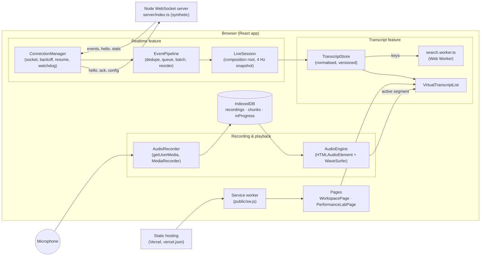
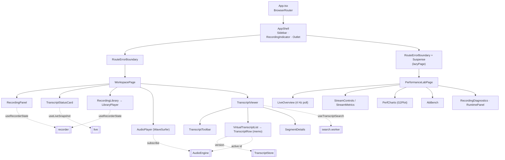
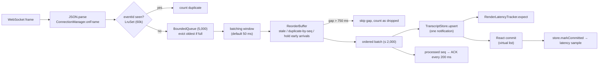
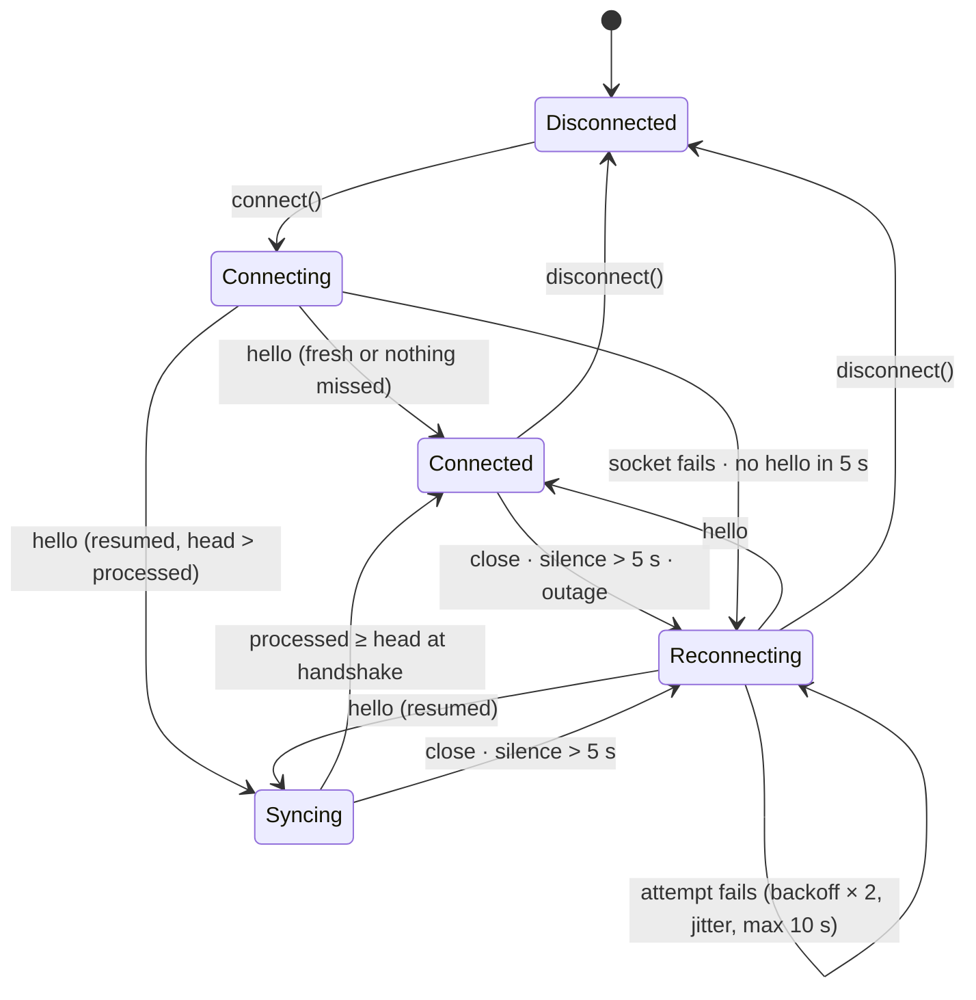
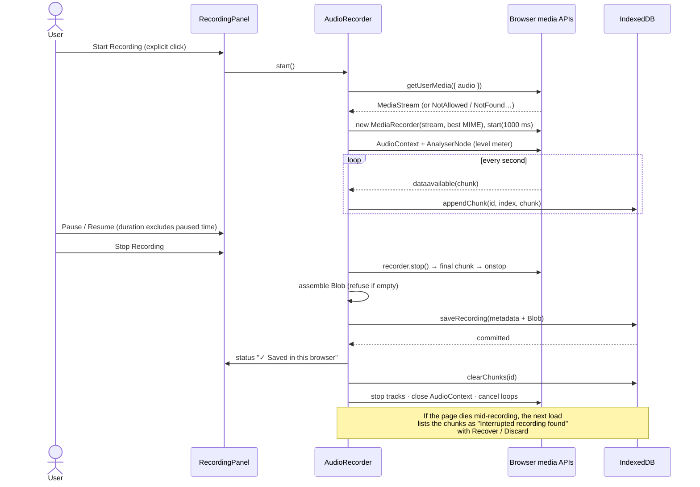
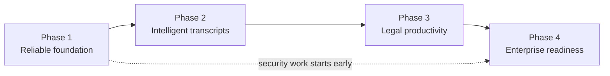

# CourtScribe — Engineering Case Study & Product Architecture Proposal

*Prepared for the founders, engineering leadership and product leadership of Adalat AI*

---

## How to read this document

Every capability in this document carries one of four labels. The labels matter: this is a proof of concept, and the value of the discussion depends on being precise about what exists.

| Label | Meaning |
|---|---|
| **[Implemented]** | Present in the repository and working in the application today. |
| **[Simulated]** | Working, but driven by synthetic or demonstration data (for example the transcript stream). |
| **[Partial]** | Implemented with known gaps, or not yet verified on every target platform. |
| **[Proposed]** | Not built. A recommendation or future opportunity. |

Performance figures quoted in this document were **observed during development on a single MacBook in Chrome** (mostly headless Chrome driven by Playwright). They illustrate behaviour and relative differences; they are not benchmarks and say nothing about courtroom hardware.

Nothing in this document describes Adalat AI's existing product. Where Adalat AI is mentioned, it is as the context in which these ideas could be useful.

---

## Table of contents

1. [Executive summary](#1-executive-summary)
2. [Problem statement and product thinking](#2-problem-statement-and-product-thinking)
3. [What exists today — capability map](#3-what-exists-today--capability-map)
4. [Feature-by-feature explanation](#4-feature-by-feature-explanation)
5. [Technical architecture](#5-technical-architecture)
6. [Code walkthrough: how everything works](#6-code-walkthrough-how-everything-works)
7. [Engineering challenges I am solving as a frontend engineer](#7-engineering-challenges-i-am-solving-as-a-frontend-engineer)
8. [Architecture decisions and trade-offs](#8-architecture-decisions-and-trade-offs)
9. [Product opportunities and future scope](#9-product-opportunities-and-future-scope)
10. [Proposed product evolution roadmap](#10-proposed-product-evolution-roadmap)
11. [How I would contribute at Adalat AI](#11-how-i-would-contribute-at-adalat-ai)
12. [Key takeaways for leadership](#12-key-takeaways-for-leadership)
- [Appendix A — Repository map](#appendix-a--repository-map)
- [Appendix B — Known limitations and open issues](#appendix-b--known-limitations-and-open-issues)

---

## 1. Executive summary

### What CourtScribe is

CourtScribe is a browser application for working with courtroom proceedings. In one workspace a legal professional can:

- **record** the proceedings from a microphone, with the recording saved on the device and recoverable if the browser is interrupted;
- **follow** a transcript as segments arrive in real time, with speaker names and timestamps;
- **search and navigate** very long transcripts (tested with 100,000 segments) without the interface slowing down;
- **play back** a recording and see the matching transcript segment highlighted, or click a statement to jump to that moment;
- **inspect reliability**: a "Performance Lab" measures how the application behaves under load and when the network fails.

It is built with React 19, TypeScript (strict), Vite, Tailwind CSS, React Router, G2Plot, `@tanstack/react-virtual` and WaveSurfer.js, plus a small Node.js WebSocket server (`ws`). The codebase is about 8,300 lines across `src/`, `shared/` and `server/`, with 62 unit tests and a set of Playwright browser tests.

### What it is not — stated up front

- **There is no speech recognition.** The transcript is **[Simulated]**: a local WebSocket server generates synthetic Malayalam deposition segments. Recording audio does **not** produce transcript text, and the application never claims it does.
- **There is no translation** feature in the code.
- **Recordings never leave the device.** There is no cloud upload, authentication or encryption.
- **The live transcript server is not deployed.** The frontend can be hosted on Vercel; the WebSocket server needs separate hosting (Section 8).

### Why I built it

Courtroom technology has an unusual combination of constraints: very long sessions, continuous data, unreliable connectivity, users who are not technologists, and records whose integrity matters. Those constraints live mostly in the frontend — in how the browser handles real-time data, media capture, storage, failure and clarity of status. I built CourtScribe to work through those problems concretely rather than in the abstract.

### The engineering objectives

1. **Stay responsive under continuous data.** Real-time updates must never freeze the interface (measured, not assumed).
2. **Never lose or misrepresent data.** Duplicates, out-of-order messages, dropped connections and interrupted recordings are handled explicitly — and the interface never shows "Saved" or "Complete" unless that is true.
3. **Scale to long proceedings.** A 100,000-segment transcript behaves like a 100-segment one.
4. **Be understandable without training.** Every status (recording, connection, saving) is visible in plain language.
5. **Measure instead of guessing.** Performance claims come from instrumentation inside the app.

### Why this is relevant to a courtroom technology company

Any product that captures proceedings, streams transcripts and lets legal professionals navigate them faces exactly these frontend problems, regardless of the AI behind it. Speech recognition quality matters; but if the interface freezes during a long hearing, loses a recording when a tab reloads, or leaves a judge unsure whether recording is running, the product fails at the moment of use. CourtScribe is evidence of how I approach that layer.

---

## 2. Problem statement and product thinking

The table summarises the problem space; each problem is then discussed. "How CourtScribe addresses it" always refers to code that exists unless labelled otherwise.

| Problem | CourtScribe's response | Status |
|---|---|---|
| Long proceedings, huge transcripts | Virtualised rendering, normalised store | [Implemented] |
| Finding a statement | Off-main-thread search, jump to time | [Implemented] |
| Following live information | Batched streaming, "follow live" with hold-your-place | [Implemented] on [Simulated] data |
| Speakers and timestamps | Speaker labels, timestamps, segment details | [Implemented] on [Simulated] data |
| Recording and retaining audio | Browser recording, device storage, recovery | [Implemented]; iOS [Partial] |
| Unreliable connectivity | Reconnect, resume, offline app shell | [Implemented] |
| Responsiveness during updates | Batching, render isolation, measurement | [Implemented] |
| Knowing what the system is doing | Explicit, text-labelled statuses everywhere | [Implemented] |
| Information overload | Focused workspace; diagnostics separated | [Implemented] |

### 2.1 Long proceedings and lengthy transcripts

**The practical problem.** A full day of testimony can produce tens of thousands of transcript segments. A naive web page renders every one as DOM elements; at that scale it becomes slow to load, slow to scroll and slow to respond to clicks.

**Why it matters.** A lawyer checking what a witness said an hour ago cannot wait for a sluggish page during a hearing.

**How CourtScribe addresses it.** Only the rows on screen exist in the DOM (virtualisation). With 50,000 segments loaded, 16–23 rows were mounted while scrolling, and fast-scroll tests ran at about 57 frames per second. The transcript data lives outside React in a normalised store, so adding segments never copies a 100,000-item array.

**Limitations.** The live transcript store grows without limit during a session (deliberately: it is a record). Very long sessions on low-memory devices would need windowing or paging from storage.

### 2.2 Finding a specific statement

**The practical problem.** "When did the witness mention Exhibit P3?" Scanning manually is impractical.

**Why it matters.** Cross-examination, objections and arguments often depend on quoting earlier testimony precisely.

**How CourtScribe addresses it.** Text search runs in a Web Worker (a background thread), so typing never blocks the page; matches are highlighted with previous/next navigation. "Jump to" accepts a timestamp. Searching 100,000 segments took about 11 ms in the worker.

**Limitations.** Search is exact substring matching on speaker and text. There is no semantic search, no transliteration-aware matching for Malayalam/English mixing, and no cross-hearing search ([Proposed], Section 9).

### 2.3 Following incoming transcript information

**The practical problem.** New segments arrive continuously. If the view always jumps to the newest line, a reader who scrolled up to check something loses their place.

**Why it matters.** Reading back while proceedings continue is normal courtroom behaviour.

**How CourtScribe addresses it.** The list follows live updates only while the reader is at the bottom. Once they scroll up, their position is held and a "N new segments — follow live" button appears. Partial (still-being-revised) segments are shown in italics with a "partial" tag and are replaced in place by the final version.

**Limitations.** The incoming segments are synthetic. Real ASR output (revisions, corrections, latency) would need validation of this interaction model with users.

### 2.4 Speaker identification and timestamps

**The practical problem.** A statement is only useful if you know who said it and when.

**How CourtScribe addresses it.** Every row shows a timestamp, a colour-coded speaker label (Presiding Judge, Public Prosecutor, Defence Counsel, PW-1 Witness, Bench Clerk) and the text. Selecting a row shows its sequence number, ID, exact start/end times, duration and confidence.

**Limitations.** Speakers and confidence values come from the synthetic generator ([Simulated]). Real speaker diarisation is [Proposed].

### 2.5 Recording and retaining courtroom audio

**The practical problem.** A recording that disappears because a tab reloaded, a laptop slept or storage filled up is worse than no recording, because people relied on it.

**How CourtScribe addresses it.** Recording only starts on an explicit click. Audio is backed up to on-device storage (IndexedDB) **every second** while recording. If the page is interrupted, the next visit offers **Recover** or **Discard** for the interrupted session and labels a recovered file *incomplete*. Finished recordings are only labelled "Saved" after the storage write is confirmed; a storage-quota failure is reported, never hidden.

**Limitations.** Storage is per-browser, per-device and unencrypted; clearing site data deletes it. iOS Safari and desktop Safari are untested ([Partial]). Court recording rules and consent are the user's responsibility; the app says so.

### 2.6 Unreliable internet connectivity

**The practical problem.** Courtroom networks drop. A real-time client that silently stops, or duplicates and reorders data after reconnecting, corrupts what the user sees.

**How CourtScribe addresses it.** The client reconnects automatically with exponential backoff and jitter, resumes from the last acknowledged event, removes duplicates, restores order, detects silently dead connections, and shows a distinct "Syncing" state while catching up. Recording is fully independent of the network. In production builds a service worker lets the application open offline, and saved recordings play offline.

**Limitations.** Offline support covers the app shell and local recordings; there is no offline queue for edits or sync of recordings to a server ([Proposed]).

### 2.7 Responsiveness during continuous updates

**The practical problem.** At high event rates, updating the interface for every message saturates the main thread.

**How CourtScribe addresses it.** Events are batched (default 50 ms window) and applied to the store once per batch. In a side-by-side benchmark built into the app at 500 events per second, the naive approach averaged 16 frames per second with 67 long tasks; the optimised approach held 60 frames per second with none (details in Section 4.13).

### 2.8 Understanding recording and connection status

**The practical problem.** "Is it recording? Is the transcript live?" must be answerable at a glance by a non-technical user.

**How CourtScribe addresses it.** Recording and transcript streaming have separate panels with text statuses ("Recording", "Recording paused", "Connected · live", "Reconnecting — attempt 3 · retry in 1.6 s", "Syncing"). A red banner is visible on every page while recording, without scrolling. Status is never conveyed by colour alone.

### 2.9 Managing information without overwhelming the user

**How CourtScribe addresses it.** The Workspace contains only courtroom tasks. Engineering diagnostics live in a separate Performance Lab, explicitly framed as an engineering area. Features that do not exist yet ("Export", "Certify transcript") are visibly disabled with a reason rather than faked.

---

## 3. What exists today — capability map

| Area | Capability | Status |
|---|---|---|
| Workspace | Case details, recording panel, transcript stream panel, saved recordings, playback, transcript | [Implemented] |
| Case data | Case `CR/2026/00421`, District Court Ernakulam, Witness Deposition, Malayalam | [Simulated] |
| Recording | Microphone selection, start/pause/resume/stop, timer, level meter, app-wide indicator | [Implemented] |
| Recording storage | IndexedDB, per-second chunk backup, confirmed save status, quota handling | [Implemented] |
| Interrupted recordings | Recover / Discard; recovered files marked incomplete | [Implemented] |
| Recording library | Play, seek, volume, speed, download original, share, rename, confirmed delete | [Implemented]; Safari/iOS [Partial] |
| Playback ↔ transcript | Binary-search active segment, click-to-seek, auto-scroll | [Implemented] |
| Transcript stream | WebSocket server with partial/final events, 10–500 events/s, fault injection | [Simulated] content, [Implemented] transport |
| Connection management | Five states, backoff with jitter, handshake timeout, dead-connection watchdog | [Implemented] |
| Event processing | Dedupe, bounded queue, batching window, reorder, gap handling, resume | [Implemented] |
| Transcript UI | Virtualised list, search (Web Worker), jump to time, selection, follow-live | [Implemented] |
| Large datasets | 1K / 10K / 50K / 100K synthetic transcripts | [Implemented] / [Simulated] data |
| Performance Lab | Live metrics, charts, stress controls, naive-vs-optimised A/B harness, audio diagnostics | [Implemented] |
| Offline | Service worker precaching (production builds) | [Implemented] |
| Deployment | Vercel config for the frontend | [Implemented]; WebSocket hosting [Proposed] |
| Translation | — | Not implemented |
| Speech-to-text, diarisation | — | Not implemented |
| Guided tour, testing checklist, feedback form | Requested during the project; not built | Not implemented |
| Export / Certify transcript | Visible, disabled with an explanation | Not implemented |

---

## 4. Feature-by-feature explanation

### 4.1 Courtroom workspace and session organisation — [Implemented], data [Simulated]

**What it does.** One page (`/workspace`) brings together the case, the recording controls, the transcript stream status, the saved recordings, a playback panel and the transcript.

**Problem it solves.** During a hearing, switching between tools costs attention. Everything needed for the session is on one screen; the recording and connection statuses are visible near the top.

**How it works.** The case details come from a single constant. Each recording stores the case ID, case name and session ID. The transcript can come from the live stream or from a "recorded session" (10K or 100K synthetic segments starting at 00:00), which is useful for testing audio synchronisation.

**Technical implementation.** `src/pages/WorkspacePage.tsx` composes `Card`, `KeyValueGrid`, `RecordingPanel`, `TranscriptStatusCard`, `RecordingLibrary`, `AudioPlayer` and `TranscriptViewer`. Case constants: `src/features/case/caseSession.ts` (`CASE.reference`, `CASE.name`, `CASE.sessionId`). Layout: `src/components/layout/AppShell.tsx` and `Sidebar.tsx`.

**Why this approach.** Composition of independent feature modules (recording, realtime, transcript, audio) keeps each workflow testable on its own and lets the page stay thin.

**Current limitations.** There is one hard-coded case and session. There are no case lists, hearing dates, users or permissions.

### 4.2 Audio recording and microphone management — [Implemented]

**What it does.** Lets the user choose a microphone, start, pause, resume and stop recording, and see a timer, a live level meter, the captured size, the format and the recording ID.

**Problem it solves.** Capturing the proceedings reliably, with constant visibility that capture is happening.

**How it works.**
- The microphone is only requested when the user clicks **Start Recording**; nothing is captured on page load.
- Device names appear after permission is granted (a browser privacy rule); the list refreshes when devices are plugged in or removed.
- The best supported format is chosen at runtime (WebM/Opus in Chrome; MP4/AAC is in the candidate list for Safari) and the real MIME type is kept — a file is never renamed to look like another format.
- Pause time is excluded from the duration.
- If the microphone is unplugged, recording stops and the audio captured so far is kept, with a clear message.
- If the browser's permission prompt is never answered, the user can cancel.
- A red banner ("Recording audio 00:12 · Stop recording") is visible on every page; the app warns before closing the tab.
- After a configurable duration (default 60 minutes, `VITE_RECORDING_WARN_MINUTES`) the app warns that the recording should be stopped and downloaded.

**Technical implementation.** `src/features/recording/AudioRecorder.ts` (framework-agnostic class using `navigator.mediaDevices.getUserMedia`, `MediaRecorder`, `AudioContext` + `AnalyserNode`), `recordingSession.ts` (app-wide singleton and `useRecorderState`), `RecordingPanel.tsx`, `LevelMeter.tsx`, `RecordingIndicator.tsx`.

**Why this approach.** The recorder is an app-wide object rather than state inside a component, so navigating between pages never cuts a recording. The level meter writes directly to the DOM sixty times a second instead of re-rendering React. All browser APIs are injected (`RecorderEnv`), which is why permission-denied, no-microphone, device-unplugged and empty-recording cases have unit tests without hardware.

**Current limitations.** Not verified on Safari or iOS. One recording at a time. No audio processing (gain, noise suppression are explicitly disabled to preserve the original).

### 4.3 Recording storage and download — [Implemented]

**What it does.** Saves every recording on the device and lets the user download the original file with a descriptive name such as `CR-2026-00421_witness-deposition_2026-11-16T15-31-44Z.webm`.

**Problem it solves.** Recordings must survive reloads, crashes and accidental tab closes, and must be exportable as the unmodified original.

**How it works.**
- Every second while recording, the newest audio chunk is written to IndexedDB.
- On stop, the full file is written; only when IndexedDB confirms the write does the recording show **"✓ Saved in this browser"**. Until then it shows "Saving…"; if the browser refuses (for example, storage quota), it shows **"Not saved — browser storage refused it"** and remains downloadable from memory.
- Downloads are byte-for-byte identical to what was recorded (verified in a browser test).
- Each recording tracks whether it has been downloaded; leaving the page warns if any recording has not been downloaded.

**Technical implementation.** `src/features/recording/recordingStorage.ts` (`IndexedDbPersistence` with `recordings`, `chunks` and `inProgress` object stores; `MemoryPersistence` for tests), `AudioRecorder.finalize()`, `RecordingLibrary.tsx`.

**Why this approach.** IndexedDB stores binary data (Blobs) efficiently and survives reloads. Per-second chunking bounds what an interruption can lose to about one second.

**Current limitations.** Unencrypted, per-browser, evictable by the browser under storage pressure, and deleted when site data is cleared. No server backup.

### 4.4 In-app audio playback and recording library — [Implemented], Safari/iOS [Partial]

**What it does.** A "Saved recordings" section lists each recording with its name, case name and ID, date and time, duration, size, format, save status, download status and session ID. Actions: **Play**, **Download original**, **Share…** (native share sheet where supported), **Rename**, **Delete** (with confirmation), and **Open in transcript player**. An accessible player offers play/pause, a seek bar, current time and total duration, volume and playback speed. Interrupted sessions appear with **Recover recording** and **Discard**.

**Problem it solves.** Reviewing what was said, on the device, without the internet, and sharing the original file.

**How it works.** The player plays directly from the stored Blob. It works around a Chrome quirk (MediaRecorder WebM files have no duration header) by seeking past the end so the browser computes the real duration. If the browser cannot play a format (for example a file recorded by another browser), it says so and suggests downloading the original rather than failing silently.

**Technical implementation.** `RecordingLibrary.tsx`, `LibraryPlayer.tsx` (labelled range inputs with `aria-valuetext`, status regions), `navigator.share({ files })`, `navigator.storage.estimate()` for storage usage.

**Current limitations.** iOS Safari behaviour (playback of its own MP4 recordings, the share sheet) has not been tested on a device.

### 4.5 Live transcript streaming — transport [Implemented], content [Simulated]

**What it does.** A local Node.js server streams transcript events over a WebSocket at 10, 50, 100 or 500 events per second. Each segment arrives as zero to three *partial* hypotheses followed by a *final* version, imitating how live speech recognition revises text.

**Problem it solves (for the POC).** It provides realistic, controllable load and failure conditions for building and measuring the client.

**How it works.** The server generates deterministic synthetic Malayalam deposition dialogue (`TranscriptGenerator`, seeded PRNG), assigns each event a sequence number and ID, keeps the last 50,000 events in a ring buffer for resume, and supports bursts, injected duplicates, injected reordering and forced disconnects.

**Technical implementation.** `server/index.ts`, `shared/protocol.ts`, `shared/transcriptGenerator.ts`, `shared/transcriptEvents.ts` (`expandSegment`).

**Current limitations.** It is a simulator. It is not connected to any audio, and it is not deployed with the frontend.

### 4.6 WebSocket connection management — [Implemented]

**What it does.** Maintains the connection and shows its state: *Disconnected*, *Connecting*, *Connected*, *Reconnecting* (with attempt number and retry countdown) or *Syncing* (catching up after a reconnect).

**How it works.**
- Exponential backoff with full jitter (250 ms doubling up to 10 s, randomised) so many clients do not reconnect in lockstep.
- On reconnect, the client identifies itself; the server resumes from the last sequence number the client acknowledged (acknowledgements are sent every 200 ms).
- A handshake timeout (5 s) abandons sockets that open but never complete the handshake.
- A watchdog treats 5 s of silence as a dead connection (the server sends stats every second), catching failures that never fire a close event.
- If the server restarts (new session), the client starts a fresh transcript rather than mixing two sessions, and says so.

**Technical implementation.** `src/features/realtime/ConnectionManager.ts`, `backoff.ts`, `connectionStatus.ts`. Nine unit tests drive it with a fake WebSocket and fake timers (`connection.test.ts`).

### 4.7 Transcript event processing — [Implemented]

**What it does.** Turns a raw, possibly messy stream into an ordered, de-duplicated sequence of store updates.

**How it works.** For each incoming event: discard if its `eventId` was seen (bounded LRU of 60,000 IDs) → append to a bounded queue (5,000; oldest evicted and counted if full) → after the batching window (default 50 ms; 16/50/100/250 selectable) drain up to 2,000 events → restore sequence order, holding early arrivals until gaps fill or time out (750 ms) → apply the whole batch to the store in **one** update.

**Technical implementation.** `EventPipeline.ts`, `BoundedQueue.ts`, `LruSet.ts`, `ReorderBuffer.ts`, composed in `liveSession.ts`.

### 4.8 Transcript search and navigation — [Implemented]

**What it does.** Search box with match count and previous/next, highlighted matches, "Jump to" a timestamp (`hh:mm:ss`, `mm:ss` or seconds), click to select a segment and see its details.

**How it works.** A Web Worker holds a lower-cased index of `speaker + text` and is updated incrementally as segments arrive or are revised. Queries are debounced (120 ms); stale results are discarded by request ID; results return as a transferable `Int32Array`. While the live transcript grows, an active search is refreshed at most once a second. Jump-to-time uses binary search over segment start times.

**Technical implementation.** `useTranscriptSearch.ts`, `search.worker.ts`, `searchCore.ts`, `TranscriptToolbar.tsx`, `TranscriptStore.indexAtTime`.

**Observed.** On a 50,000-segment transcript, a worker search took about 7 ms end to end versus 26 ms for the same search on the main thread; on 100,000 segments, about 11 ms with no long tasks.

### 4.9 Speaker identification and timestamps — UI [Implemented], data [Simulated]

Covered in 2.4. Implementation: `TranscriptRow.tsx` (memoised row with timestamp, speaker badge, text, confidence and a per-row render counter used for diagnostics), `speakers.ts`, `SegmentDetails.tsx`.

### 4.10 Large transcript rendering and virtualisation — [Implemented]

**What it does.** Renders 1K–100K segments with only visible rows in the DOM; keeps the reader's place during live updates; dynamic row heights.

**Technical implementation.** `VirtualTranscriptList.tsx` (`@tanstack/react-virtual`, overscan 6, measured row heights, row keys from segment IDs), `TranscriptStore.ts` (normalised data), `TranscriptRow` wrapped in `React.memo` with stable callbacks.

**Observed.** 50K segments: about 0.7 s from selection to rendered; 16–23 rows mounted while scrolling quickly at ~57 fps. Switching to a 100K dataset produced one 168 ms long task (synthetic data generation and building the search index on the main thread).

### 4.11 Language and translation — not implemented

The transcript language is Malayalam (synthetic). There is no translation layer, no original/translated toggle and no side-by-side view in the code. Section 9.2 proposes how it should work.

### 4.12 Connection recovery and sequence handling — [Implemented]

Combining 4.6 and 4.7: the server replays from the last acknowledged sequence; the client discards replayed events it already processed (counted separately as "replay duplicates"); events evicted from the server's buffer during a long outage are reported as unrecoverable gaps rather than silently skipped. Observed in one run: a server-forced disconnect was recovered in 49 ms with no lost events; a simulated 3-second outage went *Reconnecting → Syncing → Connected* with replayed duplicates discarded and zero gaps.

### 4.13 Performance Lab — [Implemented]

**What it does.** An engineering diagnostics page (`/performance-lab`), deliberately separate from the courtroom workflow. Every number carries a badge: *Browser-measured*, *Server-reported* or *Simulated*.

- **Live metrics:** dataset size, mounted rows, incoming and processed events per second, queue depth, event-to-render latency (p50/p95), search time, frame rate, long tasks, connection status and the dashboard's own render rate.
- **Stress controls:** dataset size, event rate, start/stop, bursts (+1,000 / +10,000), injected duplicates and reordering, server-forced disconnect, simulated network outage, reconnect, batching window.
- **Charts (G2Plot):** throughput, latency, frame rate and blocking time, queue depth and render rate over the last 60 seconds.
- **A/B comparison:** runs a *naive* implementation (all rows mounted, `setState` on every event) and the *optimised* one (virtualised, batched) on the same event stream, one after another, each on its own connection.
- **Audio recording diagnostics and resource tracking:** separate from WebSocket metrics.

Observed in one A/B run (1,000 seed segments, 500 events/s, 10 s each):

| Metric | Naive | Optimised |
|---|---|---|
| State updates requested | 5,124 (one per event) | 178 (one per batch) |
| Peak mounted rows | 3,047 | 18 |
| Row renders | 164,939 | 2,528 |
| Event → render p50 / p95 | 66 / 135 ms | 33 / 54 ms |
| Frames per second (average / worst second) | 16 / 9 | 60 / 60 |
| Long tasks / total blocking time | 67 / 2,842 ms | 0 / 0 ms |

**Technical implementation.** `PerformanceLabPage.tsx` (lazy-loaded), `LiveOverview.tsx`, `PerfMonitor.ts`, `PerfCharts.tsx`, `LineChart.tsx`, `ab/AbBench.tsx`, `ab/NaiveLiveList.tsx`, `ab/runMeter.ts`, `ab/benchSearch.ts`, `RuntimePanel.tsx`, `RecordingDiagnostics.tsx`.

### 4.14 Performance metrics and diagnostics — [Implemented]

How the numbers are produced (all inside the app):

| Metric | Source |
|---|---|
| Frames per second | `requestAnimationFrame` callbacks counted per second |
| Long tasks, blocking time | `PerformanceObserver({ type: 'longtask' })` (Chromium); Σ(duration − 50 ms) |
| JS heap | `performance.memory` (Chromium only; labelled as such) |
| Event → render latency | `performance.now()` at socket receive → React layout-effect commit of that store version (`RenderLatencyTracker`) |
| Processing latency | receive → applied to the store |
| Render counts | layout-effect counters per row and per list, React `Profiler` durations in dev builds |
| Resource cleanup | a registry (`src/lib/resources.ts`) that every socket, worker, observer, timer, chart, audio element, microphone stream and object URL registers with and releases |

### 4.15 Responsive design and accessibility — [Implemented], manual audit [Partial]

- Desktop: collapsible navy sidebar (persisted). Below 1024 px: top bar and slide-in navigation drawer.
- An automated audit (`e2e/ui-audit.ts`) checks seven viewport sizes (1920×1080 to 390×844) for horizontal and vertical overflow, panel overflow, unnamed controls, text contrast (computed against the actual painted background) and small touch targets, including while recording and streaming. It found and led to fixes for: invisible button text (conflicting utility classes), unreadable disabled controls, a hidden second scroll layer on phones, truncated labels, unnamed charts and 16 px touch targets.
- Statuses use `role="status"`/`aria-live`; form controls are labelled; status is always text plus colour.
- **Not yet done:** a manual keyboard-only pass and a screen-reader (VoiceOver/NVDA) pass.

---

## 5. Technical architecture

### 5.1 Overall system architecture



**In plain English.** Three independent paths meet in the browser. The **transcript path** runs from the WebSocket server through a connection manager and an event pipeline into a data store that the list renders. The **recording path** runs from the microphone into the recorder and on-device storage. The **playback path** reads recordings back and highlights the matching transcript segment. They share nothing except the screen: audio never goes to the server, and the transcript never comes from the audio.

### 5.2 Frontend architecture and state management

There is no global state library. Each domain is a plain TypeScript class that owns its resources and exposes `subscribe` / `getSnapshot`, which React reads through `useSyncExternalStore`:

| Domain object | File | Read by React via |
|---|---|---|
| `live` (`LiveSession`) | `realtime/liveSession.ts` | `useLiveSnapshot()` — snapshot published at 4 Hz |
| `liveTranscript` (`TranscriptStore`) | `transcript/TranscriptStore.ts` | `store.subscribe` / `store.getVersion` |
| `recorder` (`AudioRecorder`) | `recording/recordingSession.ts` | `useRecorderState()` |
| `AudioEngine` (per Workspace visit) | `audio/AudioEngine.ts` | `subscribe` / `subscribeActive` |
| `PerfMonitor` (per Lab visit) | `perf/PerfMonitor.ts` | `usePerfState(monitor)` in leaf panels |

Three rules follow from this design:

1. **High-frequency data never becomes React state.** Socket messages, playback time and microphone level are handled outside React; React sees batched or throttled snapshots, or values are written straight to the DOM (time readout, level meter).
2. **Subscriptions live in leaf components.** The Performance Lab page itself subscribes to nothing that ticks; each panel owns its subscription, so a metrics sample re-renders only that panel.
3. **Nothing is allocated during render.** Objects that own browser resources (audio elements, sockets) create them lazily from effects or event handlers, because React may discard a render.

### 5.3 Data models

```ts
// shared/transcript.ts
export interface TranscriptSegment {
  id: string;
  speakerId: SpeakerId;
  speakerName: string;
  text: string;
  startTime: number; // ms from session start
  endTime: number;
  confidence: number; // synthetic in this POC
  sequenceNumber: number;
  isPartial?: boolean;
}
```

```ts
// shared/protocol.ts — one WebSocket frame per event
export interface TranscriptEvent {
  eventId: string;          // duplicates and replays reuse it
  sequenceNumber: number;   // ordering and resume
  segmentId: string;        // partials and the final share it
  timestamp: number;        // server send time
  speakerId: SpeakerId;
  text: string;
  eventType: 'segment.partial' | 'segment.final';
  startTime: number; endTime: number; confidence: number;
  replay: boolean;
}
```

Recordings (`StoredRecording` in `recordingStorage.ts`) carry `id`, `name`, `caseId`, `caseName`, `sessionId`, `createdAt`, `startedAt`, `durationMs`, `mimeType`, `size`, `filename`, `endedBy`, `downloaded` and the `blob`.

### 5.4 Component hierarchy and data flow



### 5.5 Transcript event-processing pipeline



### 5.6 WebSocket connection lifecycle



### 5.7 Audio recording lifecycle



### 5.8 Deployment architecture

| Piece | Today | Production recommendation |
|---|---|---|
| Frontend | Static build (`vite build` → `dist/`); `vercel.json` rewrites all routes to `index.html`, caches hashed assets for a year and never caches `index.html`, `sw.js` or the precache manifest | Same |
| Offline | `public/sw.js` precaches the files listed in `precache-manifest.json` (emitted by a small Vite plugin in `vite.config.ts`); production builds only | Same, plus update prompts |
| WebSocket server | Runs locally via `npm run dev` (`concurrently` + `tsx watch`) on port 8787 | **[Proposed]** separate host with persistent connections (Render, Railway, Fly.io); TLS (`wss://`); URL provided via `VITE_STREAM_URL` |
| Configuration | `VITE_STREAM_URL`, `VITE_SAMPLE_AUDIO_URL`, `VITE_RECORDING_WARN_MINUTES` | Per-environment variables |

Vercel serverless functions are not suitable for a long-lived WebSocket server, and an HTTPS page cannot connect to a plain `ws://` address. Without a configured `VITE_STREAM_URL`, the deployed app works fully except for the live transcript stream.

---

## 6. Code walkthrough: how everything works

All snippets below are taken from the repository.

### 6.1 WebSocket implementation

**Connection establishment and handshake** — `ConnectionManager.ts`. On `open`, the client sends `{ type: 'hello', clientId }`. The server decides whether this is a fresh client (start at the live head) or a resuming one (start after its last acknowledgement). The client's response to the server's `hello` decides between *Connected* and *Syncing*:

```ts
// src/features/realtime/ConnectionManager.ts
private onHello(hello: HelloMessage): void {
  this.clearHandshake();
  const processed = this.handlers.onHello(hello);
  // A different server session: the previous server's stats no longer describe anything.
  if (this.s.sessionId !== hello.sessionId) this.s.server = null;
  this.s.sessionId = hello.sessionId;
  // …reconnect timing and backoff reset…
  this.processedSeq = processed;
  // Missed events are being replayed: "syncing" until the pipeline has caught up to the head at handshake time.
  if (hello.resumed && hello.headSeq > processed) {
    this.s.syncTargetSeq = hello.headSeq;
    this.setState('syncing');
  } else {
    this.s.syncTargetSeq = null;
    this.setState('connected');
  }
}
```

The server side of resume (`server/index.ts`) replays from the ring buffer and reports anything that was evicted during a long outage, instead of pretending it never existed:

```ts
// server/index.ts — handleHello
const lastAck = lastAckByClient.get(clientId);
const resumed = lastAck !== undefined;
let startSeq = headSeq + 1;
let unrecoverable = 0;
if (resumed) {
  startSeq = lastAck + 1;
  const oldest = oldestBufferedSeq();
  if (startSeq < oldest && headSeq > 0) {
    unrecoverable = oldest - startSeq;
    startSeq = oldest;
  }
}
```

**Event listeners and parsing.** Handlers are attached as `ws.onopen/onmessage/onclose/onerror`. `onFrame` stamps `performance.now()` at receipt (the start of every latency measurement), parses JSON and routes `event`, `stats` and `hello` messages. Malformed frames are ignored. A late `onclose` from an old socket is ignored by checking `this.ws !== ws`, and `detach()` nulls every handler so a replaced socket cannot call back into the manager.

**Reconnection and liveness.** The same 200 ms interval sends acknowledgements and acts as a watchdog:

```ts
// src/features/realtime/ConnectionManager.ts — inside the ACK interval
const online = this.s.state === 'connected' || this.s.state === 'syncing';
if (online && performance.now() - this.lastFrameAt > STALE_CONNECTION_MS) {
  this.closeSocket(4002, 'stale connection');
  this.markDropped(`No data from server for ${STALE_CONNECTION_MS / 1000} s`);
  this.scheduleRetry();
  return;
}
if (online && this.processedSeq > this.s.lastAckSent) {
  this.send({ type: 'ack', seq: this.processedSeq });
  // …
}
```

`backoff.ts` implements full jitter: `round(random() × min(maxMs, baseMs × 2^attempt))`. A unit test asserts the ceilings `[250, 500, 1000, 2000, 4000, 8000, 10000, 10000]`.

**Validation, batching, duplicates.** `EventPipeline.ingest` does O(1) work on the hot path — duplicate check, bounded enqueue, schedule a flush — so the socket handler never waits on processing:

```ts
// src/features/realtime/EventPipeline.ts
ingest(event: TranscriptEvent, receivedAt: number): void {
  this.c.received++;
  this.inMeter.add(1, receivedAt);
  if (this.seen.checkAndAdd(event.eventId)) {
    this.c.duplicateById++;
    if (event.replay) this.c.replayDuplicates++;
    return;
  }
  if (this.queue.push({ event, receivedAt })) this.c.queueDropped++;
  if (this.queue.size > this.c.maxQueueDepth) this.c.maxQueueDepth = this.queue.size;
  this.schedule(this.opts.windowMs);
}

private schedule(delay: number): void {
  if (this.flushTimer) return;
  this.flushTimer = setTimeout(() => {
    this.flushTimer = null;
    this.flush();
    // Backlog larger than one batch: keep draining, but yield to the event loop (and React) between batches.
    if (this.queue.size > 0) this.schedule(0);
  }, delay);
}
```

**Sequence numbers.** `ReorderBuffer` restores order. A bug worth describing because a test found it: the gap timer originally started only when the pending set was empty. With batching, a whole batch is pushed before draining, so the timer never started and a single lost event could stall the transcript until 5,000 later events forced it open. The fix:

```ts
// src/features/realtime/ReorderBuffer.ts
push(seq: number, item: T, now: number): PushResult {
  if (seq < this.nextSeq) return 'stale';
  if (this.pending.has(seq)) return 'duplicate';
  if (seq < this.maxSeen) this.outOfOrder++;
  else this.maxSeen = seq;
  // Any arrival ahead of the expected seq may be waiting on a gap; the clock starts at the earliest one.
  if (seq > this.nextSeq && now < this.oldestPendingAt) this.oldestPendingAt = now;
  this.pending.set(seq, { item, at: now });
  return 'accepted';
}
```

**Backpressure on the server.** A stalled client (for example a backgrounded tab) must not make the server buffer without limit; it is disconnected and will resume from its acknowledgement:

```ts
// server/index.ts
function writeEvent(c: ClientState, ev: StoredEvent, replay: boolean): void {
  if (c.ws.bufferedAmount > MAX_BUFFERED_BYTES) {
    // Backpressure: never buffer unboundedly for a stalled client (e.g. a backgrounded tab).
    c.live = false;
    c.ws.terminate();
    return;
  }
  // …send
}
```

**Cleanup.** `disconnect()` clears the retry timer, the handshake timer and the ACK interval, closes the socket and releases its resource-registry entries. `LiveSession.disconnect()` flushes the pipeline so nothing queued is lost.

### 6.2 Transcript rendering

**Applying a batch** — one store notification per batch, regardless of how many events it contains:

```ts
// src/features/realtime/liveSession.ts
private apply(batch: Queued[]): void {
  const segments = new Array<TranscriptSegment>(batch.length);
  const receivedAt = new Array<number>(batch.length);
  for (let i = 0; i < batch.length; i++) {
    const q = batch[i] as Queued;
    segments[i] = toSegment(q.event);
    receivedAt[i] = q.receivedAt;
  }
  this.store.upsert(segments); // one store notification per batch
  this.renderLatency.expect(receivedAt);
}
```

**The normalised store.** `TranscriptStore` keeps `order: string[]`, `byId: Map`, `indexById: Map` and a `version` counter. `upsert` appends new segments and replaces revised ones (partial → final) in place. Replaced records get new object identity, so only their memoised rows re-render; unchanged rows keep identity and do not:

```ts
// src/features/transcript/TranscriptStore.ts
upsert(segments: readonly TranscriptSegment[]): void {
  if (segments.length === 0) return;
  const start = this.order.length;
  const updates = new Map<number, TranscriptSegment>();
  for (const s of segments) {
    const index = this.indexById.get(s.id);
    if (index === undefined) {
      this.indexById.set(s.id, this.order.length);
      this.order.push(s.id);
    } else if (index < start) {
      updates.set(index, s);
    }
    this.byId.set(s.id, s);
  }
  this.bump();
  // …notify append and update listeners (the search worker keeps its index in sync from these)
}
```

**Virtualisation.** `VirtualTranscriptList` subscribes to the store's version and lets `@tanstack/react-virtual` decide which rows exist:

```ts
// src/features/transcript/VirtualTranscriptList.tsx
const virtualizer = useVirtualizer({
  count,
  getScrollElement: () => scrollRef.current,
  estimateSize: () => 64,
  overscan: 6,
  getItemKey: (i) => store.idAt(i),
});
```

Follow-live is tracked with a ref plus a "row count when the reader stopped following" in state, so the "N new segments" count is derived during render rather than updated on every batch. (An earlier version did update it per batch and doubled the render rate; the Performance Lab showed it.)

**Avoiding unnecessary renders.** `TranscriptRow` is `React.memo`'d; callbacks are stable (`useCallback`); highlight text is only passed to rows that match, so typing does not re-render non-matching rows; a row's render counter updates its badge directly in a layout effect so measuring renders does not cause renders:

```ts
// src/features/transcript/TranscriptRow.tsx
useLayoutEffect(() => {
  commits.current++;
  stats.rowCommits++;
  if (counterEl.current) counterEl.current.textContent = `×${commits.current}`;
});
// …
export const TranscriptRow = memo(TranscriptRowView);
```

**Search off the main thread.** The worker keeps the index and returns sorted match indices as a transferable buffer:

```ts
// src/features/transcript/search.worker.ts
self.onmessage = (e: MessageEvent<SearchRequest>) => {
  const msg = e.data;
  if (msg.type === 'load') keys = msg.keys;
  else if (msg.type === 'append') for (const k of msg.keys) keys.push(k);
  else if (msg.type === 'update') for (const [i, k] of msg.updates) keys[i] = k;
  else {
    const t0 = performance.now();
    const matches = searchKeys(keys, msg.query);
    const res: SearchResponse = { type: 'result', id: msg.id, query: msg.query, matches, workerMs: performance.now() - t0, indexed: keys.length };
    (self as unknown as DedicatedWorkerGlobalScope).postMessage(res, [matches.buffer]);
  }
};
```

Rows test whether they match with a binary search over that sorted array (`containsSorted`), not with `Array.includes` or by building a `Set` of up to 100,000 entries.

**Playback ↔ transcript.** The active segment during playback is found by binary search and published only when its ID changes; the list re-renders only then, and only the two affected rows re-render:

```ts
// src/features/audio/activeSegment.ts
export function resolveActiveSegmentId(store: TranscriptStore, ms: number): string | null {
  if (store.size === 0 || !Number.isFinite(ms)) return null;
  const index = store.indexAtTime(ms);
  const segment = store.at(index);
  return segment && segment.startTime <= ms ? segment.id : null;
}
```

A unit test asserts at most 20 record reads to resolve the active segment among 100,000. In one observed 8-second playback, the time readout updated 481 times (directly in the DOM), the active segment changed twice, and only three row components re-rendered.

### 6.3 Audio recording

**Permission and stream.** `start()` is only called from the Start button. It requests `getUserMedia` with the selected device (echo cancellation, noise suppression and auto gain disabled to preserve the original). A start token lets the user cancel an unanswered permission prompt; if permission arrives after cancelling, the stream is released immediately. Errors are translated into plain language (`describeMediaError`: denied, not found, in use, unavailable device).

**MediaRecorder and chunks.** The first supported type from `MIME_CANDIDATES` (`audio/webm;codecs=opus` … `audio/mp4` … `audio/aac`) is used and the recorder's actual `mimeType` is kept. Every chunk is backed up:

```ts
// src/features/recording/AudioRecorder.ts
recorder.ondataavailable = (e: BlobEvent) => {
  if (e.data && e.data.size > 0) {
    this.chunks.push(e.data);
    this.set({ bytes: this.state.bytes + e.data.size, chunks: this.chunks.length });
    // Back up every chunk so an interrupted recording can be reassembled after a reload.
    const index = this.chunkIndex++;
    const meta = index === 0 ? { mimeType: (recorder.mimeType || mimeType || 'audio/webm').split(';')[0]!, startedAt, filename, ...this.caseInfo } : undefined;
    this.options.persistence?.appendChunk(id, index, e.data, meta).catch(() => this.set({ storageError: STORAGE_FAILED }));
  }
};
```

**Storage and the "Saved" guarantee.** After stop, the Blob is assembled; an empty Blob is refused with an explanation rather than shown as a recording. The status becomes *Saved* only in the success callback of the IndexedDB write:

```ts
// src/features/recording/AudioRecorder.ts — finalize()
store
  .saveRecording({ ...meta, blob })
  .then(
    () => {
      setStatus('saved'); // only now is it shown as Saved
      void store.clearChunks(id).catch(() => {}); // the backup is redundant now; a leftover is harmless
    },
    () => setStatus('failed', { storageError: STORAGE_FAILED }),
  );
```

Deleting works the other way round: the record is removed from storage first and only then from the list, so a reload immediately after "Delete" can never bring it back (a browser test found that race).

**Playback and download.** The library player plays the stored Blob through an object URL; the transcript-synced `AudioEngine` uses WaveSurfer on top of its own `HTMLAudioElement`. "Download original" is an `<a download>` on the stored Blob with a descriptive filename; "Share…" passes a `File` to `navigator.share` where supported.

**Resource cleanup.** One method releases everything a recording holds, and is safe to call more than once:

```ts
// src/features/recording/AudioRecorder.ts
private releaseMedia(): void {
  if (this.raf !== null) this.env.cancelFrame(this.raf);
  this.raf = null;
  if (this.tick) clearInterval(this.tick);
  this.tick = null;
  for (const t of this.stream?.getTracks() ?? []) t.stop();
  this.stream = null;
  if (this.audioContext && this.audioContext.state !== 'closed') void this.audioContext.close().catch(() => {});
  this.audioContext = null;
  this.analyser = null;
  this.levelBuffer = null;
  this.level = 0;
  for (const l of this.levelListeners) l(0);
  for (const r of this.releases.splice(0)) r();
}
```

Event listeners on the audio element are registered with an `AbortController` signal and removed in one call. Object URLs are revoked when recordings are deleted or replaced.

### 6.4 Supporting infrastructure worth knowing about

- **Stale code after a redeploy.** `lazyPage.ts` wraps `React.lazy`: if a page's code chunk cannot be fetched (the app was redeployed while a tab was open), it reloads once; if that fails, `RouteErrorBoundary` explains the problem with a "Reload page" button instead of a blank app.
- **Offline matching.** The service worker matches precached assets with `ignoreVary: true`, because module scripts are requested with an `Origin` header and servers send `Vary: Origin`; a strict match missed the cache and the app could not start offline. This was found only by testing a production build offline.
- **Resource registry.** `trackResource(kind)` returns a release function; notifications are coalesced per microtask because resources can be created during a React render, and a synchronous notification would update other components mid-render.

---

## 7. Engineering challenges I am solving as a frontend engineer

### 7.1 Real-time data management

**The difficulty.** The browser has one main thread for JavaScript, layout and painting. Handling each WebSocket message as a UI update means rendering at the message rate; at hundreds of messages a second that leaves no time to paint.

**The approach in CourtScribe.** Separate *ingestion* (O(1) per message), *processing* (dedupe, order, batch) and *rendering* (one store update per batch, read through `useSyncExternalStore`). Metrics are published at 4 Hz. At 500 events per second with a 50 ms window: 60 fps, no long tasks over 10 seconds, p50/p95 event-to-render of about 31/54 ms, and clicks visible on the next frame in 10–20 ms.

**Trade-offs.** Batching adds latency equal to the window. 50 ms was chosen as imperceptible for reading; the window is configurable and the Lab shows its effect.

**Before production.** Move parsing and pipeline work into a Worker if event payloads grow (ASR word-level timings, alternatives); define latency budgets with product and measure them on target courtroom hardware.

### 7.2 Frontend performance at scale

**The difficulty.** Cost scales with DOM size and with how many components re-render per change.

**The approach.** Virtualisation, a normalised store with stable object identity, memoised rows, search in a Worker, binary search for time lookups, and leaf-level subscriptions. The A/B harness exists so the improvement is demonstrated, not asserted (Section 4.13).

**Trade-offs.** Virtualisation complicates "find in page", printing and some accessibility behaviours (screen readers see only rendered rows). Dynamic row heights make programmatic scrolling approximate until rows are measured.

**Before production.** An accessible alternative view for long transcripts (structured headings/pages), an export path that does not depend on the virtual list, and moving synthetic-data generation and search-index building off the main thread (the remaining 168 ms long task).

### 7.3 WebSocket reliability

**The difficulty.** Real networks deliver duplicates, reorderings, partial outages and silent deaths; servers restart.

**The approach.** At-least-once delivery with idempotent client processing: sequence numbers, acknowledgements, server-side replay buffer, client-side dedupe and reordering, gap timeouts, explicit "unrecoverable" reporting, a syncing state, a watchdog, a handshake timeout, and fresh-session detection. Faults can be injected from the UI, and the client is unit-tested against a fake socket.

**Trade-offs.** The server holds a bounded replay buffer (50,000 events), so very long outages lose data — which is reported, not hidden. Client-side dedupe memory is bounded (60,000 IDs).

**Before production.** Authentication on the socket; a protocol version in the handshake; persistence of the replay log on the server; and agreement with backend engineers on event schemas and ordering guarantees.

### 7.4 State management

**The difficulty.** Recording, transcript streaming, playback and diagnostics run concurrently with different lifetimes: some must survive navigation (a recording), some must not (a chart).

**The approach.** Each domain is a framework-agnostic class with explicit ownership and lifecycle: app-wide singletons for things that must persist (`live`, `recorder`), per-page instances for things that must not (`AudioEngine`, `PerfMonitor`). React is a view over them. This made each domain unit-testable without React and kept React's render cycle out of real-time paths.

**Trade-offs.** It is more manual than a state library, and developers must follow conventions (snapshot immutability, subscription in leaves).

**Before production.** Document the conventions, add lint rules where possible (hook dependency linting is already enforced with oxlint), and consider a lightweight store library only if cross-domain coordination grows.

### 7.5 Browser resource management

**The difficulty.** Microphone streams, recorders, audio contexts, workers, sockets, observers, animation loops, object URLs and charts all leak if not released, and React can render (and discard) components unexpectedly.

**The approach.** Single release paths (`releaseMedia`, `dispose`), `AbortController` for listeners, a resource registry that makes leaks visible in the Performance Lab, and no resource allocation during render. A real leak was found this way: navigation could leave an audio element behind because it was created in a `useState` initializer for a render React discarded.

**Open item.** In headless Chrome the JS heap grew about 0.2 MB per Workspace ↔ Performance Lab round trip; a heap-snapshot analysis found no application object retaining the old pages. It needs confirming in a normal browser.

### 7.6 Recording reliability

**The difficulty.** A recording is only as reliable as its weakest moment: permission prompts, device changes, tab reloads, storage limits, long durations.

**The approach.** Explicit start; per-second chunk backup; confirmed saves; recover/discard for interrupted sessions; incomplete recordings labelled; device loss and recorder errors keep captured audio; empty output refused; quota failures surfaced; warnings before leaving; independence from the network.

**Trade-offs.** Chunk backup roughly doubles storage writes during recording; recordings are held in memory as well as in storage until stop.

**Before production.** Assemble the final file from storage rather than memory for multi-hour sessions; request persistent storage (`navigator.storage.persist()`); encryption at rest; verified behaviour on courtroom devices and on Safari/iOS; integrity hashes for chain-of-custody.

### 7.7 Accessibility and usability

**The difficulty.** Users are legal professionals under time pressure, not technologists. Ambiguous status is a real risk.

**The approach.** Plain-language statuses; recording visible on every page; disabled features shown honestly with reasons; readable disabled states; status never by colour alone; labelled controls; an automated audit across seven viewports. The audit found an invisible "Start Recording" label (white text on white) caused by conflicting Tailwind classes — a reminder that visual correctness must be tested, not assumed.

**Before production.** Manual keyboard and screen-reader passes; usability sessions with lawyers and court staff; localisation of the interface (not just the transcript).

### 7.8 Observability

**The difficulty.** "It feels fast" is not evidence, and performance regressions arrive silently.

**The approach.** Instrumentation inside the app: FPS, long tasks, event-to-render latency, queue depth, render counts, resource counts and the dashboard's own render cost, each labelled by source; an A/B harness; Playwright tests that run against production builds.

**Before production.** Ship a small subset as real-user monitoring (long tasks, socket reconnects, recording failures) to a backend; define service-level objectives; add performance budgets to CI.

---

## 8. Architecture decisions and trade-offs

"Alternatives" below are **retrospective recommendations and comparisons**, not a record of formal evaluations performed during the POC.

| Decision | Why | Alternatives (retrospective) | Benefits | Limitations | Production considerations |
|---|---|---|---|---|---|
| React 19 + strict TypeScript | Ecosystem, `useSyncExternalStore`, strict typing for protocols | Svelte, Solid (finer-grained reactivity) | Shared types between client and server (`shared/`) | Re-render model needs discipline at high rates | Keep real-time paths outside React |
| WebSocket instead of polling | Server pushes events with low latency and ordering | SSE (server→client only), HTTP polling | Bidirectional (ACKs, config) | Needs persistent hosting; proxies/firewalls | `wss://`, auth, heartbeat, protocol versioning |
| Batching window (50 ms) | Bounds render rate independent of event rate | Per-frame (rAF) batching; per-event | Predictable render cost; configurable | Adds up to one window of latency | Tune with product per use case |
| Virtualisation (`@tanstack/react-virtual`) | Only visible rows in DOM | Pagination, `react-window` | Works with dynamic row heights | Find-in-page, printing, screen readers | Accessible alternative views |
| Web Worker search | No main-thread blocking on 100K | Server-side search; indexed search (e.g. a trie) | ~11 ms for 100K, zero long tasks | Substring only; index memory duplicated | Server search for cross-hearing/semantic |
| MediaRecorder in the browser | No install; works on laptops and phones | Native apps, dedicated recorders | Zero infrastructure | Codec varies by browser; browser limits | Validate on court hardware; native fallback if needed |
| IndexedDB for recordings | Binary storage that survives reloads | Cache API, OPFS (Origin Private File System) | Transactional; per-second backup | Evictable; unencrypted; per-browser | OPFS for very large files; encryption; server sync |
| Audio and transcript independent | Honest separation; different lifetimes and failure modes | Coupled pipeline | Recording works with no network | No automatic alignment yet | Alignment via ASR timestamps (Section 9.7) |
| Local simulation server | Controllable load and faults | Recorded replays | Deterministic, fault injection | Not real ASR | Keep as a test harness alongside real services |
| Vercel for the frontend; separate WebSocket host | Static hosting is simple and cheap | Single platform for both | CDN, immutable caching, SPA rewrites | Two deployments to coordinate | Render/Railway/Fly.io for `wss`; shared env config |
| No global state library | Domains are classes; React reads snapshots | Redux Toolkit, Zustand | Testable without React, minimal overhead | Conventions must be documented | Revisit if cross-domain state grows |
| oxlint for hook rules | `typescript-eslint` does not support TypeScript 7 yet | ESLint with an older TypeScript | Hook dependency errors enforced | Smaller rule ecosystem | Re-evaluate when ESLint TS support lands |

---

## 9. Product opportunities and future scope

Everything in this section is **[Proposed]**. The priority ratings assume a product whose core value is accurate, trustworthy records of proceedings.

### 9.1 AI-powered transcript generation (speech-to-text)

- **User problem:** Manual transcription is slow and expensive; hearings need same-day records.
- **Proposed feature:** Stream recorded audio (live or after the fact) to a speech-recognition service that returns partial and final segments — the event model CourtScribe already handles (`segment.partial` → `segment.final`).
- **Value:** Turnaround time; searchable records from the first minute.
- **Technical challenges:** Accuracy for Indian languages and code-mixed speech (for example Malayalam–English), legal vocabulary, courtroom acoustics, latency, cost, and where audio may be processed.
- **Dependencies:** ASR models and infrastructure; an audio upload or streaming path (none exists today); consent and data-handling policies.
- **Priority:** Highest. Most other opportunities depend on it.

### 9.2 Original and translated transcript views

- **User problem:** Participants and reviewers may not read the language of the proceedings.
- **Proposed feature:** Translation as a separate layer linked to each original segment (never overwriting it), with original-only, translated-only and side-by-side views, and machine translations clearly labelled as unverified until reviewed.
- **Value:** Accessibility of records across languages.
- **Technical challenges:** Legal accuracy, segment-level traceability, layout of two scripts side by side, versioning when the original is corrected.
- **Dependencies:** 9.1; a translation service; a review workflow.
- **Priority:** High after 9.1.

### 9.3 Speaker diarisation

- **User problem:** Records must attribute statements to the judge, advocates and witnesses.
- **Proposed feature:** Automatic speaker separation, with a human mapping step from "Speaker 2" to "Defence Counsel" and correction tools.
- **Value:** Usable records without manual attribution of every line.
- **Technical challenges:** Overlapping speech, one shared microphone, consistent identities across a session.
- **Dependencies:** 9.1; potentially multi-channel audio.
- **Priority:** High; the UI already models speakers per segment.

### 9.4 Intelligent transcript search

- **User problem:** Users remember meaning ("when did the witness talk about the vehicle"), not exact words, and spelling varies across scripts.
- **Proposed feature:** Combine today's exact search with semantic search and transliteration-aware matching, always linking results to source segments and timestamps.
- **Value:** Faster preparation and review.
- **Technical challenges:** Embeddings for Indian languages, ranking quality, privacy of indexed content.
- **Dependencies:** 9.1; a search backend.
- **Priority:** Medium.

### 9.5 Context-aware case summaries

- **User problem:** Reviewing a full day of proceedings takes hours.
- **Proposed feature:** Summaries of submissions, testimony and key events, where **every sentence links to the transcript segments and audio timestamps it is based on**, marked as AI-generated and requiring human review.
- **Value:** Faster review; a navigable index of a hearing.
- **Technical challenges:** Hallucination control and source attribution; legal sensitivity.
- **Dependencies:** Reliable transcripts (9.1, 9.3).
- **Priority:** Medium, and only with traceability.

### 9.6 Search across multiple hearings

- **User problem:** Cases span many hearing dates; statements need to be compared over time.
- **Proposed feature:** Case-level organisation of sessions with search across them for authorised users.
- **Dependencies:** Server storage, a case/session model, access control (9.8).
- **Priority:** Medium.

### 9.7 Audio and transcript alignment

- **User problem:** Users need to hear exactly how something was said.
- **Proposed feature:** Use ASR word/segment timestamps to align transcripts with the actual recording, so clicking a statement plays that moment of *that* recording.
- **Value:** Verification and trust in the record.
- **Starting point:** CourtScribe already has the playback side: binary-search active segment, click-to-seek and auto-scroll (Section 6.2). What is missing is real alignment data; today it only lines up with synthetic transcripts that start at 00:00.
- **Priority:** High — relatively low frontend effort once ASR timestamps exist.

### 9.8 Secure recording management

- **User problem:** Court recordings are sensitive records.
- **Proposed feature:** Encrypted storage (on device and server), role-based access, audit trails of who accessed or exported what, retention policies, controlled sharing, and integrity hashes for chain of custody.
- **Dependencies:** Identity, a backend, policy decisions with legal stakeholders.
- **Priority:** Required before real deployments.

### 9.9 Offline-first courtroom experience

- **User problem:** Connectivity in courtrooms cannot be assumed.
- **Proposed feature:** Extend what exists (offline app shell, local recordings, resumable streams) with background synchronisation of recordings and edits when connectivity returns, upload resumption and clear sync status.
- **Starting point:** Per-second chunking already gives natural upload units.
- **Priority:** High for field reliability.

### 9.10 AI-assisted legal workflows

- **User problem:** Navigating long proceedings for references, dates and inconsistencies.
- **Proposed feature:** Assistive extraction (cited sections, exhibits, dates, names) and highlighting of possible inconsistencies, always with source links and human review, never as conclusions.
- **Priority:** Later; depends on transcript quality and trust established by earlier phases.

---

## 10. Proposed product evolution roadmap



**Phase 1 — Reliable foundation** *(largely demonstrated in this POC)*
- Done in the POC: recording reliability (chunking, recovery, confirmed saves), transcript navigation, large-transcript performance, WebSocket reliability, responsive layout, offline shell.
- Remaining: deploy the stream service (`wss`, auth); Safari/iOS and courtroom-hardware validation; manual accessibility passes; usability sessions with legal users; assembling long recordings from storage; real-user monitoring.
- Dependencies: backend hosting; access to users and devices.

**Phase 2 — Intelligent transcript workflows**
- Speech-to-text integrated into the existing partial/final event model; speaker diarisation with correction; translation as a linked layer; audio–transcript alignment.
- Dependencies: ASR/translation services; an audio transport (upload or streaming); data-handling policy.

**Phase 3 — Legal productivity**
- Semantic and transliteration-aware search; hearing summaries with source links; case-level organisation; cross-hearing navigation.
- Dependencies: Phase 2 quality; server-side storage and search.

**Phase 4 — Enterprise readiness**
- Encrypted cloud storage, permissions, audit trails, retention; offline synchronisation; multi-court deployment and configuration; operational monitoring and SLOs.
- Dependency note: security and data-handling design should start in Phase 1, even if delivered in Phase 4.

---

## 11. How I would contribute at Adalat AI

This POC is not production experience, and I do not present it as such. It is evidence of how I approach problems. In a Lead Frontend Engineer / UI Architect role I would contribute in these ways.

| Area | Contribution | Evidence from CourtScribe |
|---|---|---|
| Frontend architecture | Domain modules with explicit lifecycles; React as a view layer for real-time domains | `LiveSession`, `AudioRecorder`, `TranscriptStore` |
| Performance engineering | Budgets and measurement before optimisation; A/B evidence | Performance Lab, A/B harness |
| Real-time design | Protocol semantics (ordering, resume, idempotency) agreed with backend | `ConnectionManager`, `EventPipeline`, server resume |
| Design systems | Small, consistent component set with tested states (disabled, status, contrast) | `Button`, `SegmentedControl`, `MetricTile`, UI audit |
| Reliability and observability | Failure modes designed and tested; honest status; telemetry | Fault injection, recovery flows, resource registry |
| Browser APIs and media | Media capture, storage, workers, service workers done carefully | Recorder, IndexedDB, search worker, offline |
| Accessibility and UX | Plain language, visible status, automated plus manual audits | Status design, UI audit findings |
| AI and backend integration | Frontend contracts that tolerate partial results, revisions and latency | Partial/final segments, syncing state |
| Engineering standards | Strict types, linting of hook rules, unit and browser tests on production builds | 62 unit tests, Playwright suites, oxlint |
| Mentoring and decisions | Written trade-offs; lessons turned into rules | Sections 7–8 |

**Taking a POC to production — how I would approach it:**

1. **Agree the contracts first** with backend and AI engineers: event schemas, ordering guarantees, latency budgets, error semantics, versioning.
2. **Validate with real users and devices**: courtroom hardware, network conditions, Safari/iOS, legal staff workflows.
3. **Threat-model and data-handle** with legal and security specialists before storing real proceedings.
4. **Instrument production** from day one: reconnects, recording failures, long tasks, storage errors.
5. **Harden the delivery path**: CI with production-build tests, performance budgets, staged rollouts, error boundaries that degrade gracefully.
6. **Keep honesty in the UI** as a design principle: never show *Saved*, *Complete*, *Live* or *Verified* unless it is true.

Mistakes I made during this project, and what they changed (I think these matter as much as the successes):

- I verified routing only on the development server; a refresh on Vercel returned 404 until `vercel.json` added SPA rewrites. Production builds are now part of the browser tests.
- I left a background development server running that shared a Vite cache with the user's server and broke it. The config now uses `strictPort`, and tests no longer start a development server.

---

## 12. Key takeaways for leadership

1. **What did I build?** A browser-based courtroom workspace that records proceedings reliably on the device, plays them back offline, streams and navigates very large transcripts responsively, recovers from network failure without losing or duplicating data, and measures its own performance. The transcript content is simulated; there is no speech recognition or translation.

2. **What problems did I explore?** Responsiveness under continuous data, scale to long proceedings, real-time reliability over unreliable networks, recording integrity across interruptions, and making system status unmistakable to non-technical users.

3. **What capabilities does it demonstrate?** Frontend architecture beyond components (domain modules, data pipelines, lifecycles); performance engineering with evidence (60 fps versus 16 fps in a like-for-like A/B at 500 events per second); protocol-level thinking (sequence numbers, acknowledgements, replay, backpressure); careful use of browser media and storage APIs; and honesty in product design.

4. **What would I prioritise next?** Deploy the stream service securely; validate on Safari/iOS and courtroom hardware with real users; then integrate speech-to-text into the existing partial/final event model and build audio–transcript alignment on the playback features that already exist.

5. **How could I contribute?** By owning the frontend architecture for real-time, media-heavy legal workflows; partnering with backend and AI teams on contracts; building the observability and reliability practices that make the product trustworthy in a courtroom; and raising the engineering bar through measured decisions and clear documentation of trade-offs.

CourtScribe is a proof of concept, but the problems it works through are the ones a courtroom product meets at the moment of use. The aim is to show product thinking, architectural judgement and hands-on engineering — and the discipline to say clearly what is and is not yet true.

---

## Appendix A — Repository map

| Path | Responsibility |
|---|---|
| `server/index.ts` | Synthetic WebSocket stream: generation, rates, ring buffer, resume, fault injection, backpressure, stats |
| `shared/protocol.ts`, `shared/transcript.ts` | Wire protocol and transcript model shared by client and server |
| `shared/transcriptGenerator.ts`, `shared/transcriptEvents.ts` | Deterministic synthetic transcript; partial/final expansion |
| `src/App.tsx`, `src/main.tsx` | Routes, route error boundaries, lazy pages, service worker registration |
| `src/components/layout/*` | `AppShell`, `Sidebar`, `RouteErrorBoundary` |
| `src/components/ui/*` | `Button`, `Card`, `Badge`, `StatusIndicator`, `SourceBadge`, `MetricTile`, `SegmentedControl`, `KeyValueGrid`, `PageHeader`, `Icon` |
| `src/features/realtime/*` | `ConnectionManager`, `EventPipeline`, `BoundedQueue`, `LruSet`, `ReorderBuffer`, `RenderLatencyTracker`, `liveSession`, `backoff`, stream UI |
| `src/features/transcript/*` | `TranscriptStore`, `TranscriptViewer`, `VirtualTranscriptList`, `NaiveTranscriptList`, `TranscriptRow`, `TranscriptToolbar`, `SegmentDetails`, `useTranscriptSearch`, `search.worker`, `searchCore` |
| `src/features/audio/*` | `AudioEngine`, `AudioPlayer`, `activeSegment` (transcript-synced playback) |
| `src/features/recording/*` | `AudioRecorder`, `recordingStorage`, `recordingSession`, `RecordingPanel`, `RecordingLibrary`, `LibraryPlayer`, `LevelMeter`, `RecordingIndicator`, `RecordingDiagnostics` |
| `src/features/perf/*` | `PerfMonitor`, `LiveOverview`, `PerfCharts`, `LineChart`, `RuntimePanel`, `monitorRenders`, `ab/*` |
| `src/lib/*` | `resources` (resource registry), `stats` (percentiles, rate meters), `format`, `lazyPage`, `cn` |
| `public/sw.js`, `vite.config.ts` | Service worker; precache-manifest plugin |
| `vercel.json` | SPA rewrites and cache headers |
| `e2e/*` | Playwright: live workflow, audio sync, recording, navigation, UI audit, recording library (production build) |
| `demo/make-video.mjs` | Reproducible 30-second walkthrough video (Playwright capture, captions, voiceover, MP4 in Chrome) |

## Appendix B — Known limitations and open issues

- No speech-to-text, diarisation or translation; transcript, speakers, confidence scores and case data are synthetic.
- Live transcript server not deployed; requires a `wss://` host and `VITE_STREAM_URL`.
- Recordings are local to one browser on one device, unencrypted and evictable; no backup or sync.
- Safari, iOS Safari and Firefox not tested; long recordings validated by simulation and a 40-second real recording, not multi-hour real sessions.
- Live transcript memory grows with session length (by design).
- Headless measurement showed ~0.2 MB heap growth per Workspace ↔ Performance Lab round trip; no retaining path found; unconfirmed in a normal browser.
- `performance.memory` and the Long Tasks API are Chromium-only; the Lab labels them accordingly.
- Manual keyboard and screen-reader audits not yet performed.
- Export and Certify transcript are placeholders (disabled with explanation).
- A guided tour, testing checklist, feedback form and first-run welcome were requested during the project and are not built.
